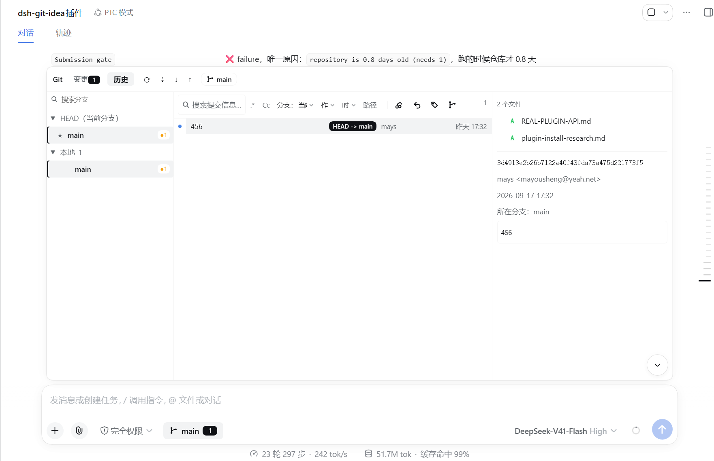
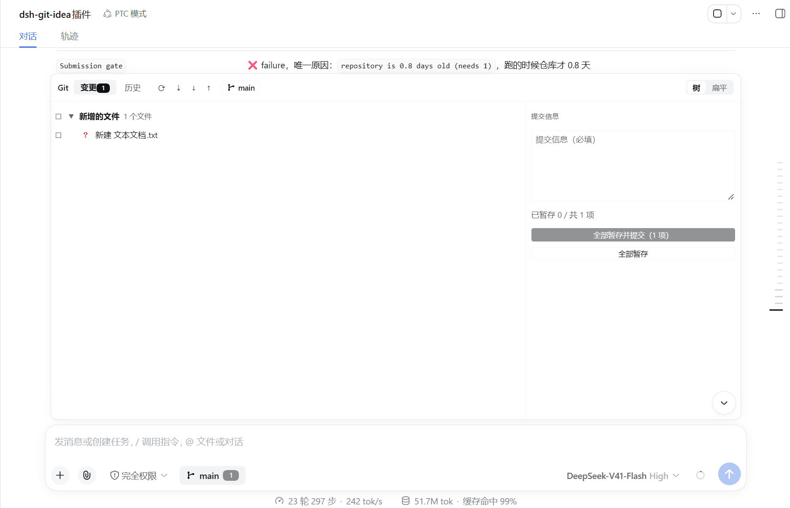
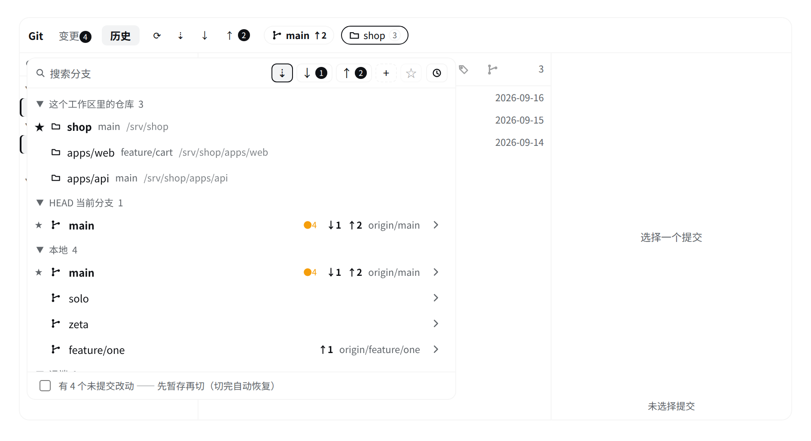
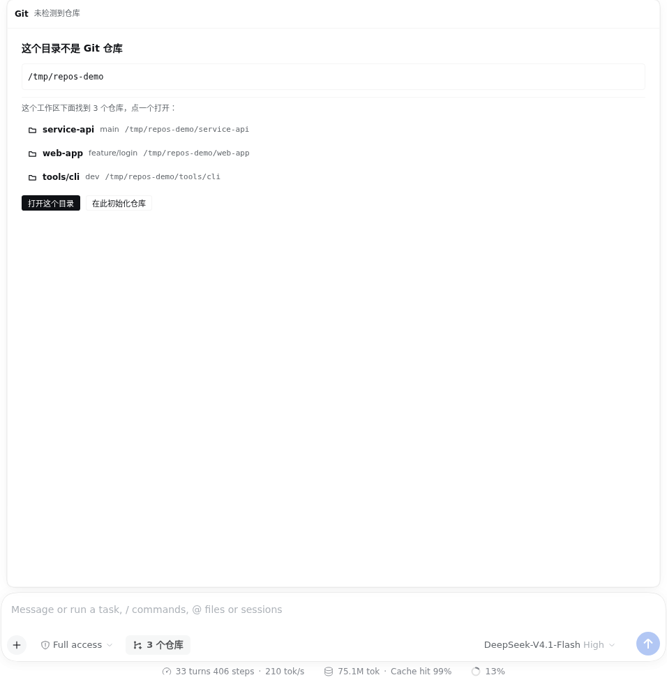
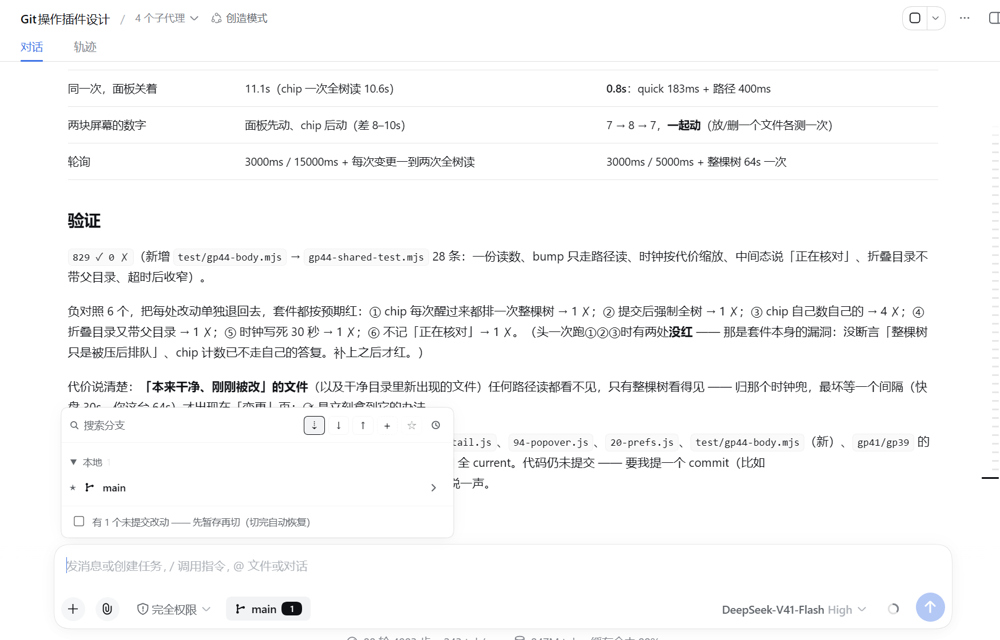

# dsh-git-idea

照着 IDEA 的 VCS 做的 Git 集成，装进 DSH 会话：输入框「**权限模式**」旁边一个 Git 图标 —— 显示当前分支与未提交改动数，**悬停**切分支，**点击**弹出 IDEA 风格的面板（分支树、提交历史与提交图、变更与暂存、提交详情、文件差异），另有一个**设置页**管提交身份、git 位置和网络参数。

**不向 DSH 注册任何模型工具**（模型要跑 git 本来就有 `bash`，见[不注册工具](#不注册工具)）。
**面板属于会话，不属于窗口**：同一页面里的每个会话各看各的工作区。
**看得见 DSH 的工作树**：模型用官方的 `create_worktree` 把会话搬进一棵链接工作树之后，chip 和面板跟着搬过去（分支、改动、历史都是那一棵的），头上多一颗工作树身份。插件**不建树、不删树、不搬会话**，只把已经发生的事说清楚 —— 见[工作树](#工作树)。

> Git integration for DeepSeek Harness, modelled on IDEA's VCS — a git icon beside the permission mode in the composer (branch + pending count), a branch switcher on hover, an IDEA-style VCS panel on click, and a settings page. Registers no model tools with DSH, and follows a session into the worktree DSH's `create_worktree` moved it to.

| | |
|---|---|
| 当前版本 | **0.3.0** |
| 下载 / 安装 | `dsh plugin --profile web add dsh-git-idea`（npm）· `github:mays-hi/dsh-git-idea`（GitHub）· 本地目录 |
| 依赖 | DSH `>=0.1.5-rc.1`（`engines.dsh`，只声明最低版本）；`@deepseek-ai/cordis ^4.0.2`（peer） |
| 仓库 | <https://github.com/mays-hi/dsh-git-idea> |

---

## 安装

要求 DSH `>=0.1.5-rc.1`（只声明最低版本；peer：`@deepseek-ai/cordis ^4.0.2`）。同一份包在 0.1.5 到 0.2 上都能跑，靠的是三处各自探测：

* **执行器**：0.1.7 把一次性 `run(spec)` 换成了 `execute(spec)` 加 `result()` —— 两种形状都认；
* **会话工作区**：0.1.7 的 `sessions.get` 只回答活着的会话 —— 解析不到时退到 `sessionPersistence` 读会话头，刚选中、还在恢复的会话因此也能读到；
* **生效目录与工作树**：0.2 起会话的目录可以移动（`SessionHeader.cwd` 保留原始项目，`workingDirectory` 投影说现在在哪），官方还给了 `create_worktree` —— 插件优先读那个投影，没有它时退回监听 `session/event` 上的 `working-directory/change`，再退回会话头。工作树清单要 `git worktree list`，与 DSH 版本无关。

```sh
dsh plugin --profile web add dsh-git-idea                    # npm
dsh plugin --profile web add github:mays-hi/dsh-git-idea      # GitHub
dsh plugin --profile web add /path/to/dsh-git-idea            # 本地
```

装完**重启 `dsh web`**。报 `ERR_PNPM_ADDING_TO_ROOT` 就在包名前加 `-w`。

> 已经跑着旧版动态插件（`<DSH_HOME>/dsh-git-idea` 那个桥）就先停掉 —— 两个都装着就是两份 chip、两个面板抢同一个 slot。

---

## 跑在哪儿

### DSH 桌面端（`dsh-app://app`）

面板的每一次读都走 `POST /dsh-git-idea/rpc`。桌面端不是把这个地址服务给浏览器，而是由 Electron 主进程把它代理给 Host：它删掉 `origin`（和 `sec-fetch-site`），改用 Host 自己那张 cookie 重新认证，再转过去。

所以判据不能是「带没带 Origin」。现在问的是平台自己那道门 —— `connection.requestRejection`，也就是 `/api` 走的同一条：Host/Origin 围栏（authority 必须是 loopback，或这份部署信任的）加浏览器会话。装在没有这个 Service 的组合里时退回到围栏本身（跨站标记被拒、Origin 必须与 authority 一致、**没有 Origin 是正常的**）。

> 旧版在这里要求「Origin 必须存在且等于 Host」，于是桌面端的每一条请求都被判 403，`git/panel` 一行都回不来 —— 点开 chip 看到的就是一个空面板。

### Windows：脚本由谁来读

这个插件的每一条命令都是一个 POSIX `sh` 脚本（`[ -d … ]`、`printf`、`command -v`）。DSH 的 shell 抽象在 Linux/macOS 上由 bash 实现，在 Windows 上由 pwsh 实现 —— 同一个字符串交给 PowerShell 就是一个解析错误，于是每一次读都会变成「这个目录不存在」/「这台机器上找不到 git」。

Windows 上 DSH 的 `shell` 默认由 pwsh 实现，而插件的每一条命令都是 POSIX `sh` 脚本 —— 同一个字符串交给 PowerShell 就是一个解析错误。但那是**这个部署的选择**，不是平台的：`shell` 是「抽象 bash 执行服务」，同一个 Windows 上也可以装配 bash 那一半。所以先问一句这个 shell 是什么语言（`$PSVersionTable`）：它自己就读得懂 POSIX 时，脚本原样交给它，和别的平台走同一条路。

读出是 PowerShell 时，脚本交给一个真的 POSIX shell：Git for Windows 自带的 `usr/bin/sh.exe`。它在三个默认安装点里找，也在**这台机器 PATH 上每个 `git.exe` 旁边**的 `usr\bin` 里找（装在 Scoop / Chocolatey / IDE 自带 / 自定义目录的 Git 靠这一条）；故意不拿 PATH 上那个 `bash` —— 它是 WSL 的，看不到 `D:\` 这样的路径。脚本走 stdin，命令行走的还是同一条 shell 通道，工作目录、超时、输出上限、沙箱策略一样都不少。

找不到 `sh.exe` 时照旧把脚本原样交出去（与加这段之前完全一致，不换一种坏法），而设置页的「读命令的 shell」那一行会直说这件事 —— 否则屏幕上只有「目录不存在」，指不到真正的原因。

别的平台上这一整段不生效：`shell` 本来就是 bash。

---

## 用法

### chip（输入框「权限模式」旁边那个 Git 图标）

| 操作 | 结果 |
|---|---|
| 看 | 当前分支 + 未提交文件数（干净时只有一个分支名，有改动时是 `3` 那个徽标）。不在仓库里时**直接写出原因**：`不是仓库` / `没有 git` / `目录不存在` / `不是目录` / `选择目录` / `读取失败`。**数字那一格自己说"核对完了没有"**：核对过、有改动是实心数字；核对过、干净就一个徽标都没有；有旧数字、正在重核是空心的旧数字；连可信数字都还没有（第一次看这个仓库，或者上次是干净的而这次正在重核）是一个空心的 `…`。**转圈的圆环只留给切换分支** —— 核对读的是整棵树，大仓库上 8–10 秒，让图标转那么久就是一颗停不下来的圈 |
| 悬停 | 分支切换卡片：切分支，以及工作区里有多个仓库时换一个仓库看（可在设置里关） |
| 点击 | 开 / 收面板 |

### 面板

```
变更 3 │ 历史   ⟳ ⇣ ↓ ↑   feature-risk ↑2 ↓1   树 扁平
─────────────┬──────────────────────┬──────────────────────
分支树        │ 变更树 / 提交列表      │ 差异 / 提交详情 /
HEAD 本地 远程 │                      │ 提交信息与提交按钮
```

| 区域 | 内容 |
|---|---|
| 顶栏 | `变更`（带数量）/ `历史` 页签；`⟳` 重读、`⇣` fetch、`↓` pull、`↑` push（四个按钮**只有记号**，名字在 `aria-label` 里；领先/落后照旧跟在记号后面，`↓2` / `↑3`）；中间是当前分支，点开切换器；一个工作区里不止一个仓库时，多一颗「仓库」chip（写着现在看的是哪一个、一共几个，点开和分支那颗是同一张卡片 —— 见[看哪个仓库](#看哪个仓库)）；右端「树 / 扁平」切换变更页视图 |
| 左栏 | 分支树：`HEAD` / `本地` / `远程`，带搜索、收藏、排序；名字旁边是等着拉 / 等着推的提交数（`↓2` / `↑3`，和卡片上那一列同一套记号；与上游一致时不标）；行尾 `›` 是该分支的动作（检出、从此分支新建分支、合并到当前分支、删除） |
| 中栏 | `变更` 页是工作区，`历史` 页是提交列表 + 提交图 |
| 右栏 | 差异 patch / 提交详情 / 提交信息与提交按钮 |

### 分支切换卡片

悬停输入框那颗 chip，或点面板顶栏的分支名，弹出同一张卡片：

| 部分 | 内容 |
|---|---|
| 顶部 | 搜索框；仓库级动作 `⇣` / `↓` / `↑` / `+` / `☆`（**只有记号**，一句话在 `aria-label` 里；角标是数字；`☆` 收藏的是列表里高亮那一行）；右端排序按钮，两种模式两个图标（`A→Z` / 时钟），当前是哪种只说给读屏 |
| 仓库 | 这个工作区里有**不止一个**仓库时，列表最上面多一段（可折叠）：文件夹字形、相对路径、分支、完整路径，当前那一个带 `★`。点一行就是让 chip 和面板改看那一个 —— 换的只是「看哪一个」，不搬会话（和面板那张清单同一条规矩）。只有一个仓库时整段不出现 |
| 分组 | `HEAD 当前分支` / `本地` / `远端`。第一组读的是 Host 清单里带 `current` 那一条 —— **不记得你最近用过什么**，当前分支换了它就是新的那一行。`远端` 那一组列**全部**远端跟踪分支（本地已有同名的也在，名字压暗一档 —— 本地那一行右边写的是它的上游 `origin/dev`，远端这一行写的是远端名 `origin`；IDEA 的 Remote 节点也是全都列，它用嵌套说明这件事，这里是一张平铺清单所以用深浅） |
| 行 | 分支名、**当前分支**那行还带着未提交改动数（`●3` —— 和面板左栏那一行同一个记号，也就是 chip 角标上那个数）、与上游的差异、上游（或远端）：差异只有**有事可做**的行才带记号 —— `↓3` 蓝的是等着拉的、`↑2` 绿的是等着推的（IDEA 的写法，数字直接写在箭头后面）；与上游一致、或者根本没有上游，都空着；行尾 `›` 是这个分支能做的事（检出、从此分支新建分支、合并到当前分支、删除 —— 删除要按两下，被 git 拒绝会多出一个「强制删除」） |

行尾那句「从此分支新建分支…」点下去，子菜单收掉、**卡片不跟着收**：卡片底部留下一行输入框，已经聚焦，写着「以 <那个分支> 为起点的新分支名」—— 回车或者「创建并切换」就建好并切过去，「取消」或 Esc 退回。悬停卡片本来是「指针一离开就收」的，这一行输入框期间它按住不收（两步删除的第二步同理）：子菜单收掉之后指针正好落在卡片外面，不按住的话 200ms 后整张卡片会连那个还没打字的输入框一起消失。

### 悬浮提示：一个都没有

浏览器自己的那个 `title` 提示框在这个插件里全部去掉了，而且**工具条上一个字都不写**：顶栏那四个同步动作（`⟳` / `⇣` / `↓` / `↑`）、中间那四个提交动作（樱桃 / 还原 / 标签 / 分支）、卡片上那排 chip，皮肤上只有记号 —— 名字只说给读屏（`aria-label`）：`重新读取仓库（忽略缓存）`、`拣选：cherry-pick，把这个提交应用到当前分支`…… 同一套规则罩着折叠三角、清空 `×`、`↑2`/`↓3` 的含义、行尾 `›` 的说明、拖动手柄）。还有一件事用**动**说而不是用字说：输入框那颗 chip 最前面那一格变成转圈的圆环 = **正在切分支**（只剩这一个用途）。改动数还没核对完不再走这里 —— 那是一次整棵树的读，大仓库上 8–10 秒，让图标转那么久就是一颗停不下来的圈；它由数字那一格说（空心的旧数字，或者还没有数字时的 `…`），读屏拿到的是同一句话（`（正在核对改动）`）。测试里有一条约束守着这件事：chip、面板、分支卡片、设置页各渲染一次，整棵元素树上不允许出现 `title`。



*`历史` 页：左边分支树（`HEAD` / `本地` / `远程`），中间提交列表与提交图，右边是选中提交的详情、改动文件与提交信息。*



*`变更` 页：没跟踪的文件也在树里（红色 `?`）；右边写提交信息，下面是「全部暂存并提交（N 项）」和「全部暂存」，右上角切「树 / 扁平」。*

面板的边角可拖动，尺寸记得住。

### 手势（与 IDEA 的树一致）

| 行 | 单击 | 双击 / 点三角 |
|---|---|---|
| 目录行（分支树、变更树、提交文件树） | 只选中 | 展开 / 折叠 |
| 未跟踪目录（git 折叠成一行的那种） | 只选中，不发读取 | 读取并展开 |
| 分支行 | 只选中 | 把历史切到该分支 |
| 分组标题（HEAD / 本地 / 远程） | 只选中 | 展开 / 折叠 |
| 文件行 | 打开差异 | — |
| 分组标题最左的复选框 | 整组进 / 出索引 | — |

### 常见动作

| 想做什么 | 怎么做 |
|---|---|
| 提交 | `变更` 页勾选 → 右栏写提交信息 → 「全部暂存并提交（N 项）」或「全部暂存」 |
| 只提交一部分 | 只勾那几个文件；再点一次勾选框 = 取消暂存 |
| 看某个文件的改动 | 在变更树或提交详情里点该文件，patch 占满正文，左上角箭头返回 |
| 切分支 | 点顶栏分支名（或悬停 chip）→ 选分支 → 检出 |
| 新建分支 | 切换器头部那个 `+`，或某个分支/提交行尾 `›` 的「从此分支新建分支…」 |
| 合并 / 拣选 / 还原 | 分支行 `›` → 合并到当前分支；提交详情右上角图标 → 拣选 / 还原 |
| 打标签 | 提交详情 → 标签图标 → 填名字 |
| 获取 / 拉取 / 推送 | 顶栏 `⇣` / `↓` / `↑`；没有上游时横幅给出一键补上（push 给「推送并设为上游」，pull 给「拉取并设为上游」）；一个远端都没配时按下去会说清为什么、要跑哪条命令（见[没有远端的时候](#没有远端的时候)） |
| 冲突 | 顶栏横幅「正在合并：N 个文件冲突」+ 继续 / 跳过 / 中止；解决并暂存后点继续 |
| 搜索历史 | 默认字面匹配，`.*` 切正则，`Cc` 区分大小写；`分支:` `作者:` 时间 路径 各是一个筛选 |
| 更早的提交 | 列表底部「加载更多」，一次 200 条 |

### 提交被 git 拒了

`git commit` 要署名，而名字和邮箱写在 **git 自己的配置里**，不在仓库里。这台机器没配过时，提交会被 git 拒绝。

两条路，都留着：设置页 **dsh-git-idea配置 → 提交身份** 里填一次（面板并不总是开着），或者在终端里跑

```sh
git config --global user.name "你的名字"
git config --global user.email "你的邮箱"
```

（不加 `--global` 只对当前仓库生效。）面板不会替你署名 —— 署谁的名字只有你知道 —— 但它会在提交区**先说**这件事，被拒之后把上面那两条原样写出来，连 git 自己最后一行一起。写完之后不用重启，下一次读取（30 秒的时钟，或任意一次暂存 / 提交）就不再提醒。

同一类失败不只出现在「提交」上：拣选、还原、合并的继续、pull 都要造提交对象，它们走同一个判据（`git var GIT_AUTHOR_IDENT`，也就是 `git commit` 自己拼身份时走的那条路，任何语言下都是同一个退出码）；而 `git add`、`git branch -d`、中止这些在没有身份的机器上照跑，面板不会把它们说成身份问题。

### 没有远端的时候

一个只在本机用过的仓库（`git init` 之后从没 `git remote add`）里，这三颗按钮按下去各有一句**它自己**的说法，而不是 git 的：

| 动作 | git 原来的答复 | 面板现在说的 |
|---|---|---|
| `⇣` fetch | **退出码 0，一个字都不说**（`git fetch --all` 只是没有对象可取）—— 按下去看起来像按钮坏了 | 「这个仓库还没有配置远端，fetch / pull / push 都没有对象可谈，所以这一步没有被执行。」+ 要跑的命令 |
| `↓` pull | 英文："There is no tracking information for the current branch…" | 同一句 + `git remote add origin <仓库地址>` |
| `↑` push | 英文："fatal: No configured push destination." | 同一句 + 第一次推送的 `git push -u origin <分支名>` |

判据是 **`git remote`**，在动作之前问一次；一个远端都没有就不起 git。用 ref 列表（`refs/remotes/*`）答不了这个问题：刚 `remote add` 完、还没 fetch 过的仓库一个远程跟踪分支都没有，而它有远端。

**有远端、但这条分支没有上游**是另一件事，由 git 自己判定（`git rev-parse @{upstream}` 解析不出来 —— 不看它那句话，网络命令没有钉住语言，pull 和 push 的说法还不一样）。这时横幅给一键补上：

- push →「推送并设为上游」（`git push -u <远端> <分支>`）；设置里那一项开着时面板自己走完这一步
- pull →「拉取并设为上游」（`git pull --set-upstream <远端> <分支>`）。它**不会**自动执行：那一步会改这条分支的跟踪关系，该由读者按
- 远端名字取配置里的（优先 `origin`），写在横幅那句里（「这个分支还没有上游（origin）」）

### 看哪个仓库

会话工作区是哪个目录，就先看那个目录里的仓库：`<dir>/.git` 存在（目录或文件都算）时，它就是当前这个仓库。

那个目录自己不是仓库时，插件**往下找**（默认两层：`<ws>/apps` 与 `<ws>/apps/web`），把找到的仓库列出来：

| 位置 | 看到什么 |
|---|---|
| 输入框 chip | 工作区下面有仓库时写的是「3 个仓库」，而不是「不是仓库」—— 点开就是那张清单 |
| 引导页 | 「这个目录不是 Git 仓库」下面一行一个：相对路径、分支、完整路径，点一个就打开它 |
| 面板顶栏 | 不止一个仓库时多一颗「仓库」chip（写着现在看的是哪一个、一共几个）；点开的那张卡片**第一组**就是这张清单，星标说的是现在看的这一个，点一行换一个 —— 旁边那颗分支 chip 打开的是同一张卡片（同一段代码、同一份读数），所以两颗都点得开、结果一样 |
| 悬浮卡片 | 悬停 chip 弹出的那张卡片，最上面也是同一张清单（见[分支切换卡片](#分支切换卡片)）—— 不打开面板也能换 |
| 设置页 | 「向下找几层」`repoScanDepth`（0–3） |

**规则是写死的，不是猜的**：

* 子孙里只认 `.git` **目录** —— 子模块和链接工作树的 `.git` 是文件，它们不是「另一个仓库」（子模块本来就出现在父仓库的改动里，工作树只在改动列表里有一条注解，见[工作树](#工作树)）；
* 不往点开头的目录里走（`.git` 自己也在里面），也不走一眼就是产物的目录（`node_modules`、`target`、`dist`、`build`、`out`、`vendor`、`Pods`……）；
* 一次扫描一个进程、**不起 git** —— 分支名是从 `.git/HEAD` 里读出来的，所以这台机器上没装 git 时也答得出来有哪几个仓库；
* 最多 24 个根，按工作区缓存；换会话、换目录、按 ⟳ 才会重新扫一遍。

**点清单里的一行只换这个面板看哪一个仓库，不搬会话** —— 会话在哪里干活是 DSH 和模型的事。工作区自己是仓库、里面还有别人的检出时，工作区自己永远是清单第一条。

**只读会话工作区里的仓库**：路径框只接受工作区自己、它下面的路径，以及 git 自己列出来的那几棵工作树（工作树可以建在工作区外面）。别的路径会被拒，页面上说得出是哪一条、工作区是哪个 —— 这条通道读的是整台机器上的仓库，请求里的路径不该由浏览器随便指。



### 工作树

DSH 0.2 起官方支持 Git 工作树：模型的 `create_worktree`（服务 `ctx.worktrees`）从源仓库的某个提交新建一条分支和一份检出，**然后把会话的工作目录搬过去** —— 默认建在**源仓库里面**的 `.agents/worktrees/<分支名>`。之后模型跑的命令都在那棵树里。

这个插件对这件事只做展示：

| 位置 | 看到什么 |
|---|---|
| chip | **最前面那颗 Git 图标自己换成工作树字形**（分支图标 → 工作树图标），不是在分支名后面再挂一颗 —— 一个 chip 从头到尾只有一个按钮。是工作树的哪一棵由字形 + 分支名说（DSH 默认拿分支名给工作树命名），源仓库是另一份检出 |
| 面板顶栏 | 那颗分支 chip **换字形**（同一颗按钮、同一个位置，不再并排第二颗"工作树"按钮） |
| 变更页 | 源仓库那条 `.agents/` 未跟踪改动带一个「工作树池」注解 |

**插件里没有「工作树清单」这个界面**：没有页签，面板那两颗 chip 展开的卡片里也没有这一组 —— 那张卡片和输入框旁那张悬浮卡片是同一段代码（仓库那一组在最上面，下面是 HEAD / 本地 / 远端）。工作树是同一个仓库的第二份检出（自己的目录、索引、HEAD；分支是几棵树共享的），把它排进那张清单，屏幕上就多出一个只在 DSH 建过树之后才存在的概念；而「现在在哪棵树上」由最前面那颗图标自己说（上面那一行）。插件不建树、不删树、不 prune、不 lock：这里没有那些 RPC。

**那条 `.agents/` 改动是正常的**：工作树池就在仓库里面，所以源仓库的 `git status` 会把它报成一条未跟踪改动。插件给它加注解，**但不隐藏它** —— git 会把整棵未跟踪目录折叠成一条（池里只有工作树时，报出来的是 `.agents/`，而不是 `.agents/worktrees/w1/`），而 `.agents/` 里完全可能还放着读者自己的文件；藏掉那条就等于连那个文件一起藏。要让它不再出现，把池目录加进 `.gitignore`（插件不替你改仓库里的任何文件）。

**跟着会话走**：模型建完树、会话目录一变，chip 和面板就重读那一棵。这个信号来自 DSH 的 `workingDirectory` 投影（Host 算、Client 收、随会话推送），不是轮询 —— 换目录动的是会话，不是仓库，靠「仓库动过了」那个信号是等不到的。

### 读不动时

每一种理由说自己的话，能做的事不同：

| 情况 | chip | 面板 |
|---|---|---|
| 路径还没定 | 还没确定看哪个目录 —— 点击填写 | 「无法确定要查看的仓库路径」+ 路径框 |
| 路径不存在 | 目录不存在：… —— 点击修改路径 | 「目录不存在」+ 路径框 |
| 路径是个文件 | 这不是一个目录：… —— 点击修改路径 | 「这不是一个目录」+ 路径框 |
| 目录在，不是仓库 | … 下面有 3 个仓库 —— 点击挑一个 | 「这个目录不是 Git 仓库」+ 仓库清单（点一个就打开）+「打开这个目录」/「在此初始化仓库」 |
| 路径不在工作区里 | … 不在工作区 —— 点击改路径 | 「这个路径不在会话工作区里」+ 工作区是哪个 + 路径框 |
| git 在，读不动它 | … 读取失败 —— 点击查看原因 | 「git 命令执行失败」+ git 的原话 |
| 机器上没有 git | …：这台机器上找不到 git —— 点击查看 | 同一页改说这件事，路径框和初始化按钮都收起（都不是出路），装好 git 再点「打开这个目录」 |

「不是 Git 仓库」那一页没有路径框：路径不是问题，能点的是下面那张清单；工作区里一个仓库都没有时，那一页只说这句话，外加「打开这个目录」和「在此初始化仓库」。



---

## 设置

Settings → **dsh-git-idea配置**。

**插件级**（写 `$DSH_HOME/dsh-git-idea.json`，默认 `~/.dsh/dsh-git-idea.json`，换浏览器一致）。这份文件在工作区之外，所以它和这个插件改的其它东西走同一条路：能不能写由**这个会话的沙箱策略**决定，写不进去时页面上会明说（而不是安静地什么也没发生）：

| 项 | 默认 | 说明 |
|---|---|---|
| 初始化仓库的默认分支 | `main` | 引导页「在此初始化仓库」执行 `git init -b <值>`；留空用 git 自己的默认值 |
| cherry-pick 时记录来源（`-x`） | 关 | 提交时是否带 `-x` |
| git 位置 | 空（用 PATH 上的 git） | 面板每一条命令都以这一个词开头；装在不在这条 PATH 上的地方（Homebrew 前缀、IDE 自带的 git、nix profile）时写绝对路径。旁边实时显示它解析到哪、什么版本、能不能跑 |
| fetch 时删掉远端已删的远程分支（`--prune`） | 开 | 关掉就是 `git fetch --all` |
| pull 用 rebase（`--rebase`） | 关 | 关掉就是 `git pull`（merge） |
| 推送没有上游的分支时自动设上游（`push -u`） | 关 | 关掉时推送失败后横幅问一句「推送并设为上游」。只关 push：pull 没有上游时横幅总是问一句「拉取并设为上游」（`git pull --set-upstream <远端> <分支>`，拉的同时把跟踪关系写进 git 配置） |
| 向下找几层仓库（`repoScanDepth`） | 2（0–3） | 工作区自己不是仓库时往下看几层；0 是「不扫」，只认工作区那一个目录（这个键出现之前的行为） |

这三条网络项是**面板给 git 的实参**，不是 git 设置的副本：没勾的就是 git 原本的行为，`push.default`、`pull.rebase` 照旧生效。设置页底部还照着实参写一遍会执行成什么（`git fetch --all --prune · git pull · …`）。

**git 自己的配置**（不在上面那个 json 里）：设置页的「提交身份」直接读写 `user.name` / `user.email`，也就是终端里的 git、IDEA、钩子看到的同一份。它先显示此刻生效的那一份**和它的来源**（`.git/config` 还是 `~/.gitconfig`），然后让你选写进哪里 —— 这台机器的所有仓库（`--global`）或只这一个仓库（`--local`）。空着的框一个字节都不写：`git config user.name ''` 正是「empty ident name」那个错误的来路。

**浏览器级**（只写当前浏览器 localStorage）：

| 项 | 默认 | 说明 |
|---|---|---|
| 后台监测仓库变化并自动刷新 | 开 | 关掉后下面的节奏选项一并失效 |
| 面板打开时每 N 秒检查 | 3（1–120） | |
| 面板关着时每 N 秒检查 | 5（2–600） | 只发一次廉价签名（读者那台机器 0.12s），所以问得比过去勤 —— 15 秒的话，终端里提交完要过十几秒 chip 才改口 |
| 面板关着时也监测 | 开 | 让 chip 的分支名和改动数保持实时 |
| 悬停弹出分支切换卡片 | 开 | |
| 面板尺寸 | 跟随输入框宽度 / 74vh | 可恢复默认 |
| 变更页视图 | 树 | 或平铺列表 |
| 切换器记忆 | — | 可清除收藏与排序（「最近用过」那份记忆没有了：当前分支直接读 Host 的清单） |

这一层里每一样都能各自恢复（面板尺寸、切换器记忆各自有一颗按钮），底部那颗「本浏览器全部恢复默认」则是一次把三样都收回初始状态：外观与节奏、面板尺寸、切换器的收藏与排序。它不动插件级那份 json，也不动 git 自己的配置。

### 一次「仓库动过了」之后，插件要花多久才排空

这条 RPC 通道**一次只跑一个处理函数**（实测：一次 8 秒的读在飞的时候，连不 spawn 的
`git/flush`、`git/config` 都要等 8 秒才回）。所以一次全树 `git status` 不只是慢，它把
整块 UI 按在那里 —— 读者那台机器上（Windows 挂载的工作区、5093 个文件、全树 status
8.1s 冷 / `-uno` 也要 5.3s）量到过：

| 场景 | 改之前 | 改之后 |
|---|---|---|
| 终端里提交一次（引用变了），面板开着 | 16 条请求，队列 **21.3s** 排空，其中 13s 是两次全树读 | 队列 **0.4s**：面板问屏上那 7 条路径（0.2s），chip 问身份（0.4s）+ 同样那几条路径（Host 那边是同一个问题，只起一个进程） |
| 同样一次，面板关着 | 4 条请求，排空 **11.1s**（chip 一次全树读 10.6s） | 队列 **0.5s**：chip 只问身份 + 上次那些脏路径 |
| 这个仓库这个浏览器第一次看 | 11s+ | 一样要一次全树读（没量过就没有数字），但那一次之后走上面两条 |

屏幕上的样子是「面板反应过来了，chip 还没」—— 面板那条 0.2s 的路径读排在 chip 那条
8–10s 的全树读后面。现在：

* **「工作区有几个改动」全局只有一份读数**（面板量的、chip 量的都写在同一处），
  chip 上那个数字就是面板「变更」页签上那个数字，两块屏幕不可能各说各话；
* 一次 bump 之后只问**屏上那些路径**，整棵树不在那条路上。这里还有个量出来的坑：
  git 把没跟踪的目录折叠成一条，而**那条本身就是自己的子树** —— 再顺手带上「它所在的
  目录」就等于把旁边整棵大树扫一遍。读者那个仓库上：

  | 问哪些路径 | 耗时 |
  |---|---|
  | 7 条（快照里那些路径本身，含 3 条折叠目录） | **280ms** |
  | 12 条（每条再带上它所在的目录） | **6138ms** ← `holox-modules` 一条吃掉了全部 |
  | 9 条（折叠目录不带所在目录） | **295ms** |

  所以折叠目录那条只问它自己；文件的所在目录留着（「旁边新出现的文件」还靠它看见）。
  另外量到一次路径读本身超过 1.5s 时，这个仓库整个收窄成只问那几条路径本身；

* 整棵树有**自己的时钟**，间隔按上一次实测的代价来定：`max(30 秒, 8 × 上次耗时)`，
  上限 5 分钟。快盘上照旧 30 秒一次；读者那台机器上一次 8 秒，于是 64 秒一次 ——
  不再每 30 秒把整条通道冻 8 秒。⟳ 按钮永远立刻整棵树重读一次；
* 还没核对出来的时候 chip **不再转圈**：数字那一格是空心的 —— 有旧数字就是空心的旧数字，没有就是 `…` —— 所以任何时候都不会空着去谎称「工作区干净」，但也不用把图标转上 8–10 秒（转圈只留给切换分支）。

代价说清楚：**「本来干净、刚刚被改」的那个文件**（以及干净目录里新出现的文件）任何
路径读都看不见，只有整棵树读能看见 —— 它由上面那个时钟兜着，所以最坏情况下要等一个
间隔（快盘 30 秒，慢盘 64 秒）才出现在「变更」页里。⟳ 是立刻拿到它的办法。

---

## 不注册工具

插件给 DSH 的只有 UI 和它自己的 RPC 通道：29 条 `host.call('git/…')`（面板、chip、设置页走的就是它们）。模型要跑 git 本来就有 `bash`，所以不注册工具。

撤掉那 8 个工具（`git`、`git_status`、`git_log`、`git_diff`、`git_commit`、`git_branch`、`git_stash`、`git_sync`）时量到的：

| 量到的 | 数 |
|---|---|
| 8 个工具的 schema | **7210 字节／每次请求**（约 1800 token，与这一轮是否碰 git 无关） |
| 只为它们存在的 Host 代码 | **约 908 / 2577 行（35%）**：`40-tools` 533 行、`20-safety` 中 160 行、`30-render` 中 215 行 |
| 客户端调用工具的次数 | **0** —— 面板只走 `host.call('git/…')`，撤工具对 UI 零影响 |

代价：`git_diff` 原先把差异渲染成 GUI 里的原生 diff 卡，现在记录里只有文本。

---

## 开发

源码按功能拆片段，构建就是按顺序拼接，没有转译、打包或压缩。改代码改 `src/`。

```sh
node build-package.mjs          # 正式包：lib/index.js + client/client.js
node build.mjs                  # 动态桥：host.js + client.js
node test/run-all.mjs           # 全部断言（跑得了的都跑，Unix 形状的按平台跳过）
node build.mjs --check && node build-package.mjs --check   # 产物是否最新
node test/bench.mjs             # 基准：200 条提交的历史列表
node test/bench-branch.mjs      # 基准：300 个分支的切换器
node test/bench-rpc.mjs <仓库>  # 基准：Host 侧每条读的冷/热耗时与子进程数（可传多个仓库）
```

`test/` 的基准就这三支。早先那几支一次性探针已经清掉：`gp35-perf` / `gp35-perf2` /
`gp36-coldwarm` 量的是同一件事，只是把仓库路径写死在量的人那台机器上，现在并进
`bench-rpc.mjs`（冷/热耗时 + 子进程计数）；`bench-watch` 拿一份早就不在 `/tmp` 里的旧版
`host.js` 做对照，本来就跑不起来。

`test/run-all.mjs` 跑断言前先检查三样东西是否落后于源码：动态桥产物、正式包产物、每个套件文件。

有四条套件要分清跑在哪：gp45 用真的 HTTP 请求问那道门（桌面端转过来的那种不带 origin 的请求必须进得来），gp47 把 process.platform 站到 POSIX 上、用一个真的 POSIX shell（Windows 借 Git 的 sh.exe，Linux/macOS 用 /bin/sh），断言插件交给它的还是**原样那段脚本** —— 这两条到处都跑；gp46 只在 Windows 上跑（用真的 PowerShell 驱动真的 git，证明封装之后读得出来），别处一句话退出；gp48 是工作树那一页，用真的仓库和真的链接工作树驱动 Host 那半。

gp34a/gp34d/gp34e 靠 sh -c 和 /tmp 驱动真 git，是 Unix 形状的：Windows 上 run-all 把它们报成 skipped 而不是算成失败；Linux/macOS 上它们照常跑，所以那边的断言总数比 Windows 多。



*开发时的验证记录：`test/run-all.mjs` 全绿、0 失败，以及「一次仓库动过之后要排空多久」的对照。*

```
package.json          npm / DSH manifest（dsh.bundle patch + dsh.client web）
cordis.patch.yml      bundle 层插入的插件行
lib/index.js          构建产物：Host 半侧（ESM，插件对象 + 同源 RPC 路由）
client/client.js      构建产物：Client 半侧（__ModuleLoader__ bundle）
src/host/*.js         Host 源码片段（14 个）
src/client/*.js       Client 源码片段（25 个）
src/pkg/*.js          正式包的 prelude / postlude
build-package.mjs     正式包构建
build.mjs             动态桥构建
host.js client.js     构建产物：动态桥读取的两个半侧（旧运行方式，保留）
docs/                 README 的图
test/                 断言套件与性能基准
```

Host 与 Client 的片段各自共享一个作用域：一个片段可以用它上面片段定义的东西，反之不行。

---

## 许可

MIT

**图标**：工作树那一颗取自 VS Code 的 [codicons](https://github.com/microsoft/vscode-codicons)（`worktree`，作者 Microsoft，[CC BY 4.0](https://creativecommons.org/licenses/by/4.0/)）。选它是因为 **git 官方没有工作树图标** —— git 项目只发行过自己的 logo，而 `git gui` / `gitk` 都早于 `git worktree`；codicons 里这一个是目前最接近事实标准的（VS Code 自己就用它表示 worktree）。其余图标都是这个插件自己画的描边字形。

---

[](https://github.com/deepseek-ai/deepseek-harness)

